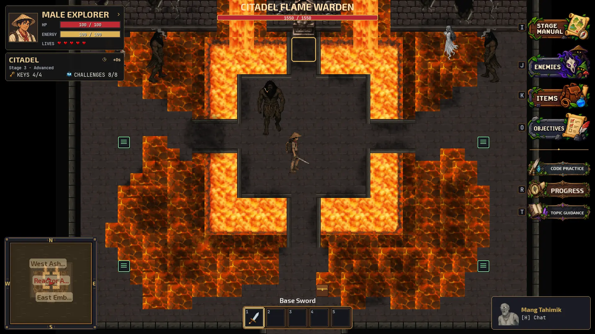

# Stage 3: Corrupted Citadel

Implemented 26 October 2026 from main `265cdb4`, incorporating the subsequent
map and collision fixes through `7e7c58e`. Castle retains the current five
mapped topic groups, as selected during implementation.

## Playable campaign

Island -> Castle -> Citadel -> completed campaign / main menu.

Castle's Throne exit now saves completion and enters Citadel. Existing saves
with Castle completed can select Citadel on the atlas. A new adventure cannot
select it before Castle completion. Developer exploration still grants no
completion, keys or challenge credit. Stage switching retains independent map
checkpoints and preserves lessons, inventory, character choice and passwords.

## Lava Chamber

The existing 40x40, 16-pixel-tile map is used unchanged visually. Its new object
layer supplies collisions, stable interaction IDs and visible lesson markers.
Molten lava, upper wall/voids and statue feet block movement. Full stone bridge
tiles remain walkable. Orange cracked stone around the perimeter is safe.

| Location (tile) | Lesson | Required challenges | Reward |
| --- | --- | --- | --- |
| Southwest (5,30) | List comprehensions and text normalization | Positive squares; clean labels | Key 1 |
| West (5,20) | Sets and unique values | Unique runes; shared runes | Key 2 |
| East (34,20) | Sorting and key functions | Rank seals; stable crate ordering | Key 3 |
| Southeast (34,30) | Search and aggregation | First matching seal; valid grouped totals | Key 4 |

Topics unlock in that order. Both challenges in a topic are required for its
one-time key. Partial completion survives closing the editor, save/reload and
atlas travel. Practice, repeated submissions and reopening completed lessons
never add another key. Behavioral cases accept equivalent correct code while
checking return types, empty inputs, duplicates, invalid data and mutation.

The arrival is at (19.5,36), with a guide at (17.5,34). A separately searchable
cache at (21,32) grants 30 bonus seconds once. Explicit cache rendering uses
the existing Chest artwork. Hold E prompts name the study/search action.

Two optional patrols contain four enemies total: Tikbalang + Kapre in the west,
White Lady + Kapre in the east. They use tier-3 combat stats, collision-safe
spawns and their own patrol bounds. Defeat/clear rewards are persistent bonus
time, never mastery keys. They cannot spawn at the southern arrival.

## Boss, assessment and exit

All four keys and all eight challenges unlock every approach to the central
reactor platform. The Flame Warden is an explicit Kapre-art variant, not a new
sprite set: 1550 HP at tier 3, directed normal/ultimate attacks, and aggression
phases below 900 and 450 HP. Armor damage increases after each break. The
arena supports retreat confirmation on every edge. Loading an unqualified
save inside this arena returns the player to safe arrival; a saved active fight
restarts at full boss health. Persisted boss victory prevents respawning.

Victory reveals `citadel_restoration_final`: normalize names, validate and
filter powers, aggregate totals, then return ranked (name,total) tuples. Its
20-minute initial limit accepts up to 300 earned bonus seconds. Declining the
briefing spends none. Failed/interrupted attempts require solved untimed
practice before retaking, keeping keys and boss victory. This chapter has one
assessment in its stage-specific pool; a retake repeats that contract.

The northern seal at tiles (19,12)–(21,14) checks all lessons, keys, boss and
assessment. Pressing E there after completion writes `citadel` into
`completed_stages` before returning to the main menu. There is no Stage 4.

## Castle reconciliation

Previously, the maps exposed five topics while the gate still required an
older 18-challenge curriculum with removed terminals. The maps are preserved;
`castle_progression.py` makes the gate match the currently mapped lessons:

| Map | Topic | Required challenges |
| --- | --- | --- |
| Lobby | Iterative structures | 3 |
| Library | Lists | 2 |
| Dungeon west entrance | Functions | 2 |
| Dungeon east entrance | Tuples | 2 |
| Throne | Error handling | 2 |

Dungeon's two cell blocks are reached from separate Lobby doors. Dining remains
optional combat. Each topic grants one of five keys. The Castle final rotation
now tests these taught concepts using lists/tuples, not untaught dictionaries.
Equivalent fully completed legacy groups migrate to replacement challenge
credit on load; partial groups do not receive mastery. Original IDs, saved
notes, stage-completion markers and checkpoints remain readable. The Lists
append-only task no longer incorrectly requires a removal membership check.

## Verification

The repository suite contains 481 tests in 51 modules, run in separate SDL
processes. An initial run found a restored fixture's quote mismatch and an
Island debug-doorway regression; both were corrected. A subsequent full run
passed all 481 tests. Verification also covers the incoming map changes.

`tests/test_citadel.py` exercises actual editors, partial saves, both challenge
orders, exactly four keys, alternative solutions, rejected mutations/errors,
an infinite-loop timeout, persistent clears/cache, assessment failure/practice,
Castle-to-Citadel handoff, and the saved final exit. Map checks use a 16x16
player body, collision-aware reachability and interaction line of sight;
Castle checks include both Dungeon arrivals. Boss asset/tier and bridge-access
checks are separate. The learning/exit walkthrough explicitly seeds boss
victory rather than claiming automated full combat playthroughs.

```bash
python tools/check_citadel.py --output-dir /tmp/citadel-preview
SDL_VIDEODRIVER=dummy SDL_AUDIODRIVER=dummy PYTHONPATH=. python -m unittest discover -s tests -p test_citadel.py
python tools/check_tutor.py --offline
```

The preview tool renders actual game frames from disposable in-memory fixtures
without modifying any player save. Mang Tahimik's online prompt and bundled
offline guide now describe playable Citadel and Castle's current lesson order.
Server revision: `citadel-campaign-20261026`.



For manual playtesting, finish Castle or load a Castle-completed slot, enter
Citadel, follow all four terminals, leave/reload after a partial topic, clear
patrols and open the cache, defeat the Warden, pass the final, then use the
northern seal. Check that the atlas marks Citadel completed after reload.

Combat balance, assessment timing and learning effectiveness still need human
learner playtesting; automated correctness and rendering checks do not measure
teaching effectiveness or prove an entire human-paced campaign was played.
